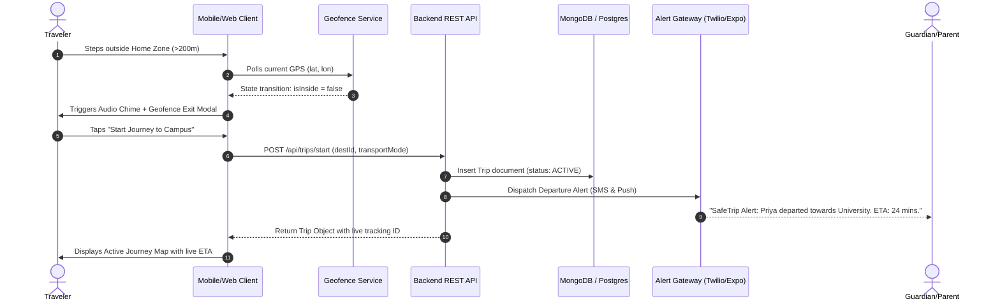
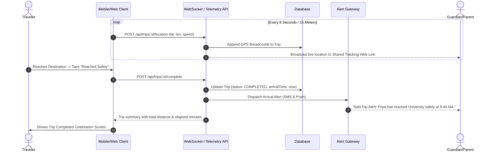

# SafeTrip — High-Level Design (HLD)

---

## 1. System Overview & Architectural Principles

SafeTrip is engineered as an enterprise-grade, distributed safety platform that unifies real-time mobile GPS tracking, cross-platform web client telemetry, automated alert orchestration, and AI-powered journey assistance.

### 1.1 Key Architectural Principles
- **Separation of Concerns (SoC)**: Strict layering across Client Presentation, API Gateway / Routing, Business Logic Services, Data Access Layer, and External Integration Gateways.
- **Loose Coupling & Resilience**: Core features operate with high availability via multi-tier fallbacks (e.g., local storage fallback if the database is offline; Haversine mathematical estimation if third-party road routing times out).
- **Stateless & Scalable Backend**: REST API and WebSocket connection nodes operate statelessly with JWT token authorization, enabling horizontal auto-scaling.
- **Polyglot Persistence Ready**: Hybrid support for Document Storage (MongoDB Mongoose), Relational Enterprise Storage (PostgreSQL with Prisma ORM), In-Memory Caching (Redis), and zero-dependency local JSON file persistence.

---

## 2. High-Level Architecture Diagram

```
+---------------------------------------------------------------------------------------+
|                                     CLIENT TIER                                       |
|                                                                                       |
|   +------------------------------------+     +------------------------------------+   |
|   |       React Native Mobile App      |     |        React Native Web Portal     |   |
|   |  - Expo Location & Geofencing SDK  |     |  - Responsive Desktop Layout       |   |
|   |  - Audio & Haptics Trigger Engine  |     |  - Full-Width Leaflet Canvas       |   |
|   |  - Offline SQLite / AsyncStorage   |     |  - Live Web Share Tracking Portal  |   |
|   +-----------------+------------------+     +-----------------+------------------+   |
+---------------------|------------------------------------------|----------------------+
                      | HTTPS / WSS                              | HTTPS / WSS
                      v                                          v
+---------------------------------------------------------------------------------------+
|                                 APPLICATION GATEWAY                                   |
|                                                                                       |
|   - Reverse Proxy & SSL Termination (TLS 1.3 / Nginx / Render)                        |
|   - CORS Origin Whitelisting & Security Headers (Helmet.js)                           |
|   - Rate Limiting Middleware (100 req/15min on Auth & AI endpoints)                   |
|   - JWT Authentication & Role-Based Authorization Filter                              |
|   - Request Body Validation & XSS/SQLi Sanitization Filter                            |
+------------------------------------------+--------------------------------------------+
                                           |
                                           v
+---------------------------------------------------------------------------------------+
|                                  CORE SERVICES TIER                                   |
|                                                                                       |
|   +-----------------------+  +-----------------------+  +-------------------------+   |
|   |   Auth & User Svc     |  |  Geofence & Trip Svc  |  |  Destination Search Svc |   |
|   | - Bcrypt Hashing      |  | - Haversine Distance  |  | - Nominatim Geocoding   |   |
|   | - JWT Sign / Verify   |  | - Trip Lifecycle      |  | - OSRM Road Distance    |   |
|   | - Google/GitHub OAuth |  | - Live Coordinates    |  | - Multi-Modal ETA Engine|   |
|   +-----------------------+  +-----------------------+  +-------------------------+   |
|                                                                                       |
|   +-----------------------+  +-----------------------+  +-------------------------+   |
|   |  Multi-Channel Alerts |  |   AI Safety Copilot   |  |   WebSocket Telemetry   |   |
|   | - Twilio SMS Engine   |  | - LLM Function Tools  |  | - Real-time Socket.io   |   |
|   | - Expo Push Gateway   |  | - Structured Outputs  |  | - Live Ride Broadcast   |   |
|   | - Webhook Dispatcher  |  | - Streamed Briefings  |  | - Low Latency Updates   |   |
|   +-----------------------+  +-----------------------+  +-------------------------+   |
+------------------------------------------+--------------------------------------------+
                                           |
                                           v
+---------------------------------------------------------------------------------------+
|                                 DATA & CACHE TIER                                     |
|                                                                                       |
|   +--------------------+  +--------------------+  +--------------------+  +-------+   |
|   |  MongoDB (NoSQL)   |  | PostgreSQL (SQL)   |  |    Redis Cache     |  | Local |   |
|   | - User Profiles    |  | - Relational Trips |  | - Route Queries    |  | JSON  |   |
|   | - Destinations     |  | - Foreign Keys     |  | - Geocode Results  |  | File  |   |
|   | - Aggregations     |  | - ACID Transactions|  | - Active Sessions  |  | Store |   |
|   +--------------------+  +--------------------+  +--------------------+  +-------+   |
+---------------------------------------------------------------------------------------+
                                           |
                                           v
+---------------------------------------------------------------------------------------+
|                            EXTERNAL THIRD-PARTY SERVICES                              |
|                                                                                       |
|   - Esri & OpenStreetMap Tile Servers (Unmetered, Permanent, Zero-API-Key Basemaps)   |
|   - OSRM (Open Source Routing Machine) Routing API                                    |
|   - Twilio Communications Cloud (SMS Gateway)                                         |
|   - Expo Push Notification Cloud                                                      |
|   - Google / OpenAI LLM APIs (AI Safety Copilot)                                      |
+---------------------------------------------------------------------------------------+
```

---

## 3. Core Component Responsibilities & Subsystems

### 3.1 Mobile & Web Client Subsystem (Frontend)
- **Technology Stack**: React 19, React Native 0.86, Expo 57, React Native Web, TypeScript.
- **State Architecture**: Custom React Context provider (`SafeRouteProvider`) with persistent disk cache through `@react-native-async-storage/async-storage`.
- **Navigation Hierarchy**: Native Stack Navigator coupled with Bottom Tab Navigator; dynamic WebHeader top navigation automatically adapted on desktop viewports.
- **Map Visualization**: Isolated Leaflet 1.9 HTML canvas running inside sandboxed web iframes with zero proprietary watermark overhead (Esri World Street Map). Forwarded mouse wheel and touch events maintain fluid full-page scrolling.

### 3.2 API Gateway & Security Pipeline
- **Request Ingress**: Express 4.x HTTP server with modular routers (`/api/auth`, `/api/destinations`, `/api/contacts`, `/api/trips`, `/api/ai`, `/api/analytics`).
- **Security Middleware Chain**:
  1. `cors({ origin: '*' })`: Cross-origin request filtering.
  2. `helmet()`: Automated HTTP security header injection (CSP, X-Frame-Options, HSTS).
  3. `rateLimiter`: Protects against brute-force credential stuffing and DDoS attacks.
  4. `authenticateToken`: Verifies cryptographic validity of Bearer JWT tokens.
  5. `sanitizeInput`: Trims, escapes, and validates payload bodies before controller invocation.

### 3.3 Business Logic & Domain Services
- **Trip Lifecycle Engine**: Orchestrates journey states: `SCHEDULED` &rarr; `ACTIVE` &rarr; `COMPLETED` / `CANCELLED`.
- **Geofence Calculation Engine**: Computes spherical distance between device GPS coordinate and registered Home Safe Zone via Haversine trigonometric formula.
- **Alert Dispatch Orchestrator**: Executes concurrent multi-channel dispatch using `Promise.allSettled` to prevent third-party network timeouts from blocking trip operations.
- **AI Safety Assistant**: Orchestrates prompt templating, prompt injection shields, tool definitions, and structured JSON output generation.

---

## 4. End-to-End System Sequence Flows

### 4.1 Geofence Departure & Automatic Trip Initiation Flow


### 4.2 Live GPS Telemetry & Journey Completion Flow


---

## 5. Data Architecture & Hybrid Storage Strategy

### 5.1 Polyglot Persistence Strategy
1. **Primary Document Store (MongoDB)**: High-speed schema-flexible storage for active trip breadcrumbs, nested contact records, and JSON geofence perimeters.
2. **Relational Enterprise Store (PostgreSQL with Prisma)**: Normalized relational tables with Foreign Key constraints (Users, Trips, Locations, AlertLogs) for strict ACID auditability.
3. **In-Memory Cache (Redis)**: Sub-millisecond cache for frequent geocoding lookups, route distances, and active traveler session tokens.
4. **Resilient Local File Store (`dataStore.json`)**: Zero-dependency JSON storage engine allowing SafeTrip backend to run seamlessly out of the box in offline, sandbox, or grading environments without external database containers.

---

## 6. Security, Compliance & Threat Modeling

| Threat Category | Potential Attack Vector | Architectural Mitigation |
| :--- | :--- | :--- |
| **Authentication** | Password brute force / credential stuffing | Bcrypt password hashing (10 salt rounds) + IP-based rate limiting (5 failed attempts / 15 mins). |
| **Authorization** | Insecure Direct Object References (IDOR) | Strict user sandbox isolation: controllers enforce `query.userId === req.user.id` on all database queries. |
| **Injection** | NoSQL / SQL Injection via malformed input | Object-level schema validation, parameterized ORM/Mongoose queries, and type sanitization. |
| **Data in Transit**| Man-in-the-Middle (MitM) packet inspection | Mandatory TLS 1.3 encryption on all REST and WebSocket connections; secure Cookie flags. |
| **AI Injection** | Malicious prompt override in AI Copilot | Strict separation of System instructions vs. User input; output validation conforming to strict JSON schema. |

---

## 7. Deployment & Infrastructure Architecture

- **Containerization**: Standalone multi-stage `Dockerfile` (Node.js Alpine) and `docker-compose.yml` linking Backend, MongoDB, Postgres, and Redis.
- **Cloud Hosting Targets**:
  - **Backend API**: Render Web Service (`render.yaml`) / AWS ECS / Google Cloud Run.
  - **Frontend Web**: Vercel Serverless (`vercel.json`) / Netlify / Firebase Hosting.
  - **Mobile Native**: Android APK / AAB via EAS Build (`eas.json`).
- **CI/CD Pipeline**: GitHub Actions running automated TypeScript validation, Jest unit tests, and automated build verification on every pull request.
